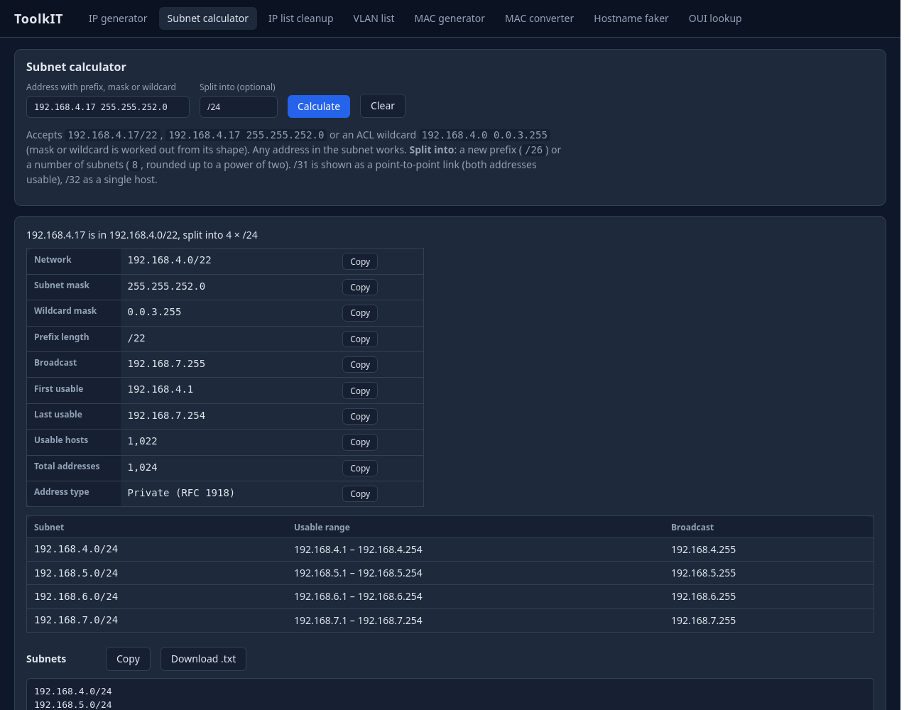
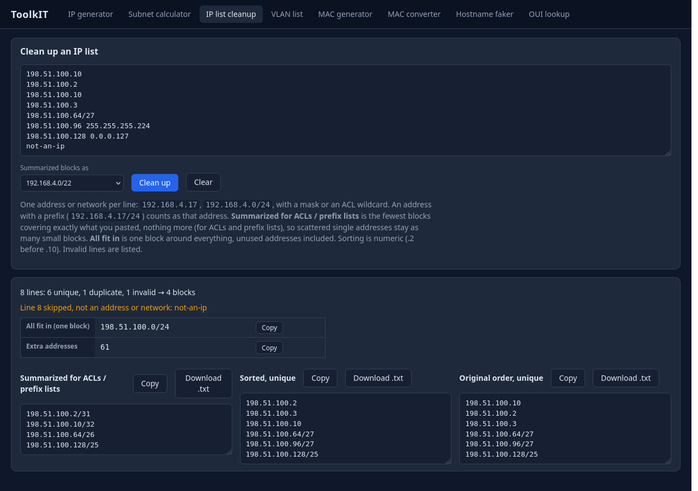
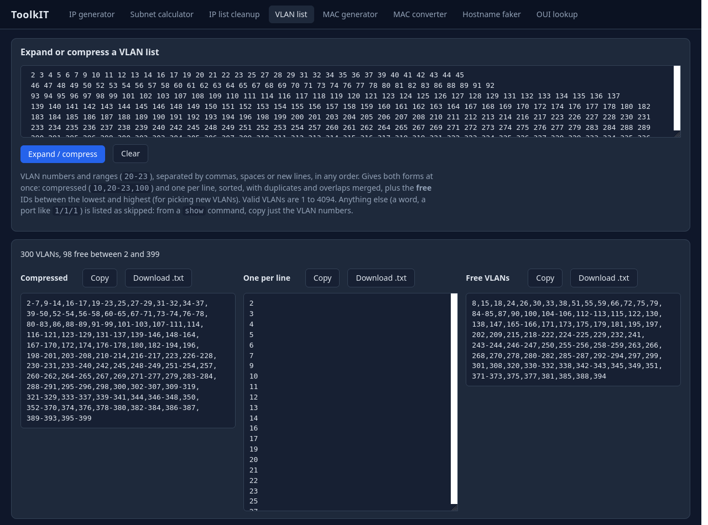
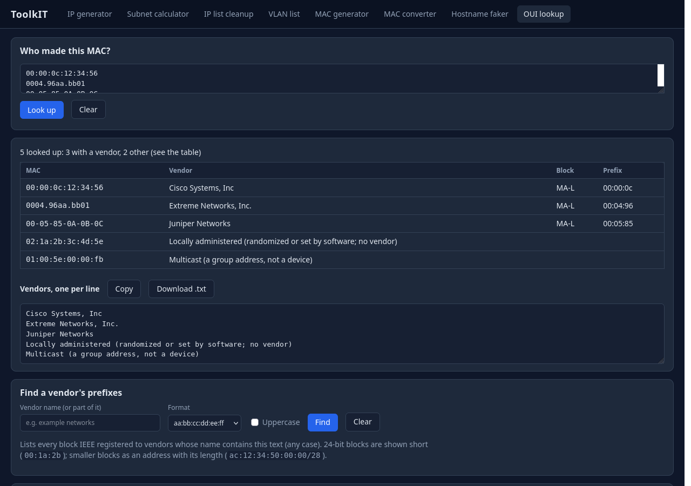
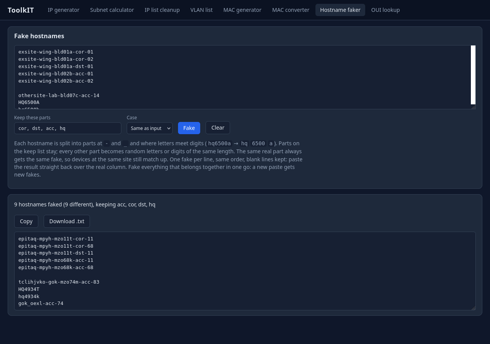

# ToolkIT

**Offline web toolkit for network engineers: subnet calculator, IP list cleanup and CIDR summarization,
VLAN list expand/compress, MAC and IP generators, MAC format converter, OUI vendor lookup and hostname
faker. One local page, no internet needed.**



*All addresses, hostnames and VLANs in the screenshots are made up (private and documentation
ranges); the MAC vendors are real public IEEE registrations.*

## Why

Everyday network jobs ("what's the wildcard for a /22?", "which VLANs are free on this trunk?",
"summarize these networks for an ACL", "who made this MAC?", "give me 300 fake IPs") usually mean
opening several different websites. That's slow, it means pasting work data into someone else's site,
and it doesn't work at sites with limited internet access. ToolkIT puts these tools in one local page
that runs on your own machine and works offline.

## Features

- **Subnet calculator:** type `192.168.4.17/22`, `... 255.255.252.0` or an ACL wildcard
  `192.168.4.0 0.0.3.255` and get network, mask, wildcard, prefix, broadcast, usable range and count,
  and the address type (private, CGNAT, documentation...), each with its own Copy button. Optionally
  split the network into smaller subnets by prefix (`/26`) or count (`8`). /31 and /32 are handled
  correctly (RFC 3021 point-to-point, single host).
- **IP list cleanup:** paste addresses and networks (one per line, prefix, mask or ACL wildcard) and get
  them deduplicated in their original order, sorted numerically (.2 before .10), and summarized into the
  fewest CIDR blocks that cover exactly the input (as prefixes, masks or ACL wildcards), plus the
  smallest single block that covers everything. Invalid lines are listed, never dropped silently.
- **VLAN list:** paste VLANs in any form (`10,20-23,100`, space-separated as in switch output, or one per
  line) and get them compressed and one per line at once, sorted, with duplicates and overlaps merged,
  plus the **free** VLAN IDs between the lowest and highest (handy when picking IDs for new VLANs).
  Anything that isn't a VLAN (1-4094) is listed as skipped.
- **OUI lookup:** who made this MAC? Type a MAC (any format) or a prefix and get the vendor, from an
  offline copy of IEEE's official registry (all block sizes, longest prefix first). Paste many for a
  vendor column. **Reverse search:** type a vendor name and get all its prefixes, e.g. for a MAC filter.
  The list is downloaded from IEEE only when you click **Update** (or imported from a file).
- **Random IP generator:** give a subnet and get random addresses filling it, or give a count (e.g. 300)
  and it picks the right subnet size (/23) for you. No duplicates, no network or broadcast addresses.
  Random networks come from 172.16.0.0/12 and 192.168.0.0/16.
- **Random MAC generator:** locally administered addresses by default (safe fakes that can't clash with a
  real vendor), fully random, or with a chosen OUI prefix.
- **MAC format converter:** paste one or many MACs and see them in every format at once
  (`aa:bb:cc:dd:ee:ff`, `aa-bb-cc-dd-ee-ff`, `aabb.ccdd.eeff`), each with its own Copy button.
- **Hostname faker:** paste a column of real hostnames and get a column of fakes, one per line in the
  same order, ready to paste back over the original. Parts you choose (e.g. a device role like `cor`)
  are kept, the rest become random letters/digits of the same shape, and the same real part always
  gets the same fake, so the data keeps its structure without its real names. Useful for sharing a
  spreadsheet without exposing real names.
- Every result has **Copy** and **Download .txt** buttons.

## Screenshots

| IP list cleanup | VLAN list with free IDs |
|---|---|
|  |  |
| **OUI lookup** | **Hostname faker** |
|  |  |

## Getting started

ToolkIT needs **Python 3.12 or newer** (tested on 3.12 and 3.14) and runs on Windows and Linux.

### Windows, portable (no install, no admin rights)

This is how it runs on a locked-down laptop: an embedded Python in a folder next to the app.

1. Clone or download this repository.
2. Download the **Windows embeddable package (64-bit)** for Python 3.14 from
   [python.org](https://www.python.org/downloads/windows/) and unzip it into a `python` folder inside
   the project.
3. Edit `python\python314._pth`: add the lines `..` (so Python finds the app) and `Lib\site-packages`,
   and uncomment `import site`.
4. Install pip: download [`get-pip.py`](https://bootstrap.pypa.io/get-pip.py) and run
   `python\python.exe get-pip.py`.
5. Install the packages: `python\python.exe -m pip install -r requirements.txt`.
6. Double-click **`run.bat`**. The app opens in your browser at `http://127.0.0.1:8780`.

### Linux (or Windows with a normal Python)

```bash
git clone https://github.com/RedDirtBits/ToolkIT.git
cd ToolkIT
python3 -m venv .venv
source .venv/bin/activate            # Windows: .venv\Scripts\activate
pip install -r requirements.txt
python -m app                        # opens http://127.0.0.1:8780 in your browser
```

## How to use it

Start the app (`run.bat` on Windows portable, `python -m app` otherwise). Pick a tab in the top bar:

- **Subnet calculator:** type an address with a prefix, mask or wildcard and press **Enter**. To
  split it, add a new prefix (`/26`) or a number of subnets (`8`) in **Split into**.
- **IP list cleanup:** paste addresses or networks one per line, choose how summarized blocks are
  written (prefix, mask or ACL wildcard) and click **Clean up**.
- **VLAN list:** paste VLANs and click **Expand / compress**. From a `show` command, copy just the VLAN
  numbers (other words and port numbers are skipped and listed).
- **OUI lookup:** the first time, click **Update from IEEE** (about 5 MB). Then type a MAC and press
  **Enter**; paste several (one per line) for a table and a "Vendors" column to copy. Under **Find a
  vendor's prefixes**, type part of a name. If Update can't get through a proxy, download the three
  files named on the page in your browser and **Import** each one.
- **IP generator:** type a count, a network, or both, pick the output style and click **Generate**.
- **MAC generator:** type a count, choose locally administered (safe fakes), fully random or a given OUI
  prefix, pick the format and click **Generate**.
- **MAC converter:** paste MACs one per line and click **Convert**: every format appears side by side.
- **Hostname faker:** paste hostnames one per line (e.g. a spreadsheet column), list the parts to keep
  (`cor, dst, acc`), pick the case and click **Fake**. Paste the result back over the real column.
  Fake hostnames that belong together in one paste: each new paste gets new fakes.

Tabs keep their results while you switch between them; **Clear** resets one tab, and reloading the page
clears all of them. `?tab=subnet`, `?tab=iplist`, `?tab=vlan`, `?tab=oui`, `?tab=mac`, `?tab=convert` or
`?tab=hosts` in the address opens a tab directly (handy as a bookmark).

### Why the IP list summary sometimes looks odd

The **Summarized for ACLs / prefix lists** box answers one specific question: *what is the smallest
set of address blocks that covers exactly these addresses, and not one address more?* That's what an
access list (ACL) or a prefix list needs. If it allowed a block that was too big, it would let in
devices it shouldn't.

Address blocks (CIDR blocks such as `/24` or `/29`) follow two rules. Their size is a power of two
(1, 2, 4, 8, 16... addresses), and each block must start at a multiple of its size. So a run of
addresses only becomes one block if it is exactly the right size and starts in exactly the right
place:

```
192.0.2.8 – .15   (8 addresses, starts at a multiple of 8)  →  192.0.2.8/29     one block
192.0.2.5 – .12   (8 addresses, starts at .5)               →  .5/32  .6/31  .8/30  .12/32
```

That's why a list of **individual devices** (for example, the in-use management addresses of one
subnet) comes out as many small blocks (`/32`, `/30`, `/29`...): the unused addresses between them
can't be included, so the gaps can't be bridged. The result is correct, it just isn't what people
expect. Lists that are already **range-shaped** (subnets plus a few hosts), as ACLs and prefix
lists usually are, merge into a short, tidy result.

To see the one network a set of addresses sits in, use **All fit in (one block)** instead. It
includes the unused addresses, and the **Extra addresses** count shows how many. The page shows a
short note when your list is mostly single addresses.

## Security and privacy

- Listens on `127.0.0.1` only (your own machine); checks the `Host` header, and `Origin`/`Referer` on
  every form post, so other websites can't drive it.
- Needs no credentials. The only data it stores is IEEE's public vendor list, in `data/oui/`. The
  hostname faker forgets everything after each paste.
- The only network access is the OUI **Update** button, which downloads IEEE's public files when you
  click it. Nothing you paste is ever sent off the machine.

## Running the tests

```bash
pip install -r requirements-dev.txt
python -m pytest -q
```

About 400 tests, using fake data only (documentation IP ranges, invented hostnames, small invented
IEEE registry files); none of them touch the network.

## Project layout

```
ToolkIT/
├── app/
│   ├── tools/    # the tools themselves: pure Python, no web code, one file per tool
│   └── web/      # FastAPI routes, Jinja2 templates, CSS and a little JavaScript (htmx)
├── tests/        # pytest tests and fake fixture data
├── screenshots/  # README images (fake data)
└── run.bat       # Windows launcher for the portable setup
```

## Development notes

- **Line endings:** `.gitattributes` keeps `run.bat` in Windows (CRLF) line endings, which batch files
  need; everything else is normal text.
- **Not in the repository, on purpose:** `python/` (the Windows embedded Python, ~50 MB of downloads),
  `data/` (each user's copy of the IEEE list), `scratch/` (throwaway experiments) and my local notes.
- Server-rendered pages with htmx (vendored, so it works offline); no JavaScript framework and no
  build step. The forms also work with JavaScript turned off (only the Copy buttons need it).

## Built with

Python, FastAPI, Jinja2 and htmx. Developed with the help of Claude (Anthropic) as a learning project.

## License

MIT: see [LICENSE](LICENSE).
